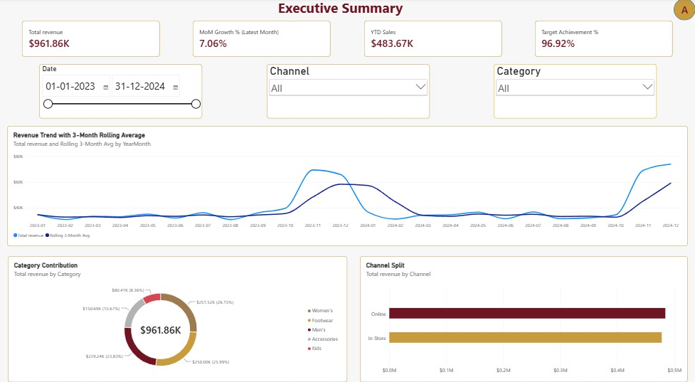
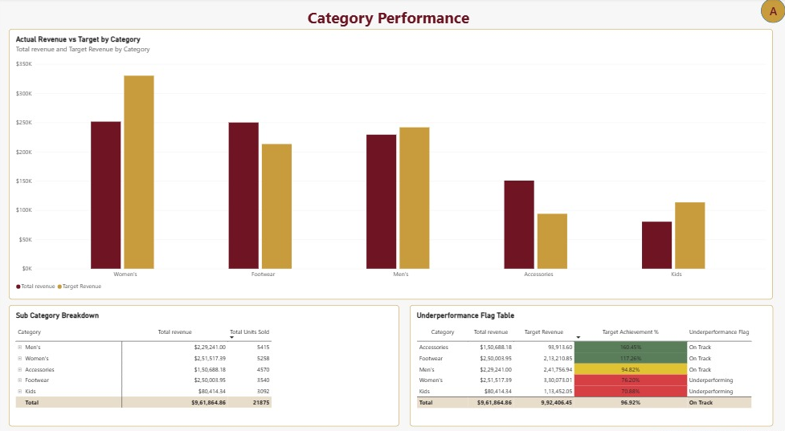
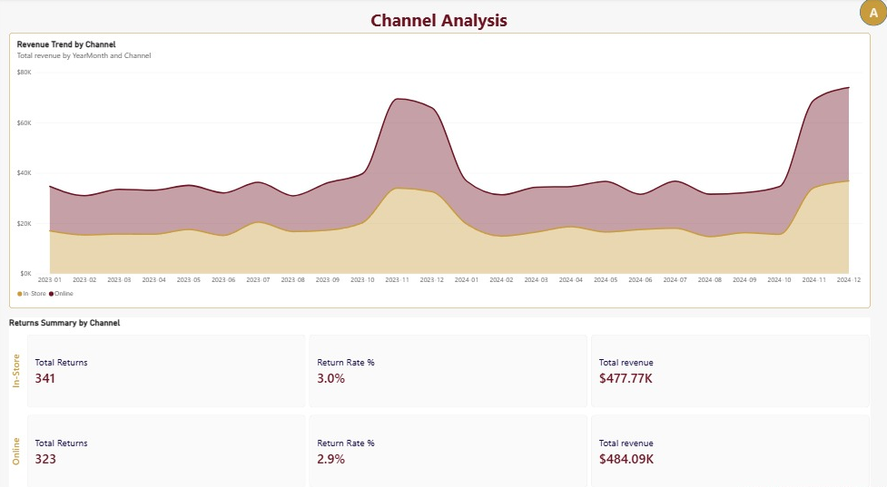
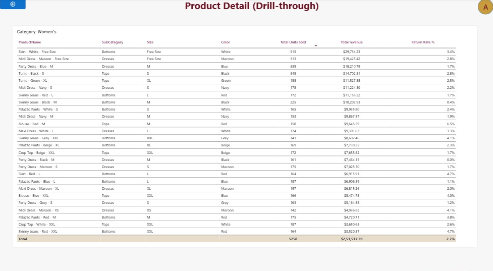

# StyleHub Fashion: Retail Sales Performance Dashboard

**Tools:** Power BI, SQL Server, Power Query, DAX

> All data in this repository is **synthetic**, created for this project. It contains no client or employer data.

## Business scenario

StyleHub Fashion is a fictional US apparel retailer selling through online and in-store channels across five categories (Men's, Women's, Kids, Footwear, Accessories). The VP of Sales keeps missing quarterly targets in some categories but has no self-service view of where the gap is.

The goal: a dashboard that lets the sales team see actual versus target by category and channel, spot underperformance, and drill from a category down to individual products without asking an analyst.

## What this project covers

- A requirement brief with KPI definitions, scope and out-of-scope items (`docs/`)
- Profiling of the raw, flat sales export in SQL Server (`sql/01_profiling.sql`)
- Cleaning and normalizing in Power Query into a star schema
- DAX for YTD, latest-month MoM growth, a rolling 3-month average, YoY, actual versus target and returns
- A four-page report with drill-through, conditional formatting and slicers
- Validation of the measures against a cleaned SQL view (`sql/02_clean_view_and_validation.sql`)

## Dashboard

**1. Executive Summary**



**2. Category Performance**



**3. Channel Analysis**



**4. Product Detail** (drill-through from Category Performance; shown here filtered to Women's)



## Key findings (from the sample data)

- Revenue is about $962K over Jan 2023 to Dec 2024, with a clear Nov to Dec seasonal peak.
- Overall target achievement is 96.9%. Accessories (160%) and Footwear (117%) are above target, Men's is at 95%, while **Women's (76%) and Kids (71%)** are flagged as underperforming.
- Online and In-Store revenue are close ($484K and $478K).
- Returns are 664 units, about 2.95% of units sold.

The sample data and targets were generated with deliberate over- and under-performing categories, so these findings illustrate what the dashboard surfaces. They are not real business results.

## Data model

```
               Dim_Category
              /             \
       Dim_Product        raw_targets
            |                  |
       Fact_Sales ---------  DateTable
```

- **Grain:** one row per product per order (order line).
- `Dim_Category` is a bridge: Product and Targets both repeat Category, so joining them directly would create a many-to-many relationship. The small table of five unique categories sits on the "one" side of both.
- `DateTable` is a marked date table connected to both sales and targets.
- All relationships are one-to-many with single-direction filters.

## KPI definitions

| KPI | Definition |
|---|---|
| Total Revenue | Sum of net revenue (returns are negative) |
| YTD Sales | Revenue from the start of the year to the last date in the selected range |
| MoM Growth % (latest month) | Latest month in the selection versus the month before |
| Rolling 3-Month Avg | Average of monthly revenue over the trailing three months |
| Target Achievement % | Actual revenue divided by target revenue |
| Underperformance Flag | Achievement below 90% |
| Return Rate % | Returned units divided by units sold plus returned units |

## DAX highlights

```dax
MoM Growth % (Latest Month) = 
VAR LastDate = MAX(DateTable[Date])
VAR CurrStart = DATE(YEAR(LastDate), MONTH(LastDate), 1)
VAR PrevStart = EDATE(CurrStart, -1)
VAR CurrRev = CALCULATE(SUM(Fact_Sales[Revenue]), ALL(DateTable),
    DateTable[Date] >= CurrStart, DateTable[Date] <= EOMONTH(CurrStart, 0))
VAR PrevRev = CALCULATE(SUM(Fact_Sales[Revenue]), ALL(DateTable),
    DateTable[Date] >= PrevStart, DateTable[Date] < CurrStart)
RETURN DIVIDE(CurrRev - PrevRev, PrevRev)

Rolling 3-Month Avg = 
VAR LastDate = MAX(DateTable[Date])
VAR Window = DATESINPERIOD(DateTable[Date], LastDate, -3, MONTH)
VAR Total3M = CALCULATE(SUM(Fact_Sales[Revenue]), ALL(DateTable), Window)
VAR Months = CALCULATE(DISTINCTCOUNT(DateTable[YearMonth]), ALL(DateTable), Window)
RETURN DIVIDE(Total3M, Months)
```

All measures are in `docs/StyleHub_Fashion_Dashboard_Blueprint.md`.

## Data preparation

**SQL profiling of the raw table found:** 251 duplicate groups, 674 return rows (negative quantity), 15 fully blank rows, inconsistent category and channel spellings, and stray spaces in State.

**Power Query:**
- One load-disabled staging query pulls from SQL Server; `Fact_Sales` and `Dim_Product` are built from it.
- Duplicates are removed twice: once on the raw rows and once after standardizing the text, because copies that differ only in spelling are not duplicates until standardized.
- Channel, category, state and product ID standardized; data types set; an `OrderType` flag (Sale, Return, Unknown) added. Returns are kept, not deleted.
- 18,265 raw rows became 18,000 after cleaning.

## Validation

A SQL view mirrors the Power Query cleaning (standardize, then de-duplicate). Key figures were recomputed from it and compared with the report:

| Check | SQL | Power BI |
|---|---|---|
| Rows after cleaning | 18,000 | 18,000 |
| Total Revenue | 961,864.86 | 961,864.86 |
| Units (net) | 21,875 | 21,875 |
| Category revenue (5 categories) | Accessories 150,688.18, Footwear 250,003.95, Kids 80,414.34, Men's 229,241.00, Women's 251,517.39 | identical |
| YTD (2024) | 483,670.93 | 483,670.93 |
| MoM, Dec vs Nov 2024 | 7.06% | 7.06% |
| Rolling 3-month average (Dec 2024) | 59,232.34 | 59,232.34 |
| Returns and return rate | 664 and 2.95% | 664 and 2.95% |
| Target achievement (overall) | 96.92% | 96.92% |

## Issues found and fixed

- **11 duplicate rows survived the first clean-up.** Validation showed Power BI 0.04% above SQL, and the gap sat only in Men's and Women's. Copies with spellings like "Mens" and "Men's" were not identical when duplicates were first removed. A second de-duplication after standardizing fixed it.
- **Target Revenue ignored the category filter.** Product and Targets had no shared path on Category. A `Dim_Category` bridge dimension was added.
- **MoM card showed 8.33%.** On a 24-month range the original measure compared the range with itself shifted by a month. A latest-month version now drives the card.
- **Rolling average returned a daily average.** It was rewritten to average monthly totals.
- **Query dependencies.** Building tables with Reference made changes to one flow into the other; a load-disabled staging query with separate outputs fixed it.
- **Negative returns** displayed as negative counts; the measure now returns the absolute number, and the return rate was adjusted to match.

## Known limitations

- Data and targets are synthetic.
- Store-level and profit-margin analysis are out of scope.
- The report reads from a local SQL Server instance and a CSV file, so refreshing it requires re-pointing the sources.

## How to open

1. Install Power BI Desktop (free) and open `StyleHub_Dashboard.pbix`.
2. To refresh the data: create a database `StyleHubDB`, import `data/raw_sales_flat.csv` as `dbo.raw_sales` (SSMS, Tasks, Import Flat File), then in Power BI use Home, Transform Data and point the SQL source to your server and `raw_targets` to `data/raw_targets.csv`.
3. To rerun the checks, run the scripts in `sql/` in order.

## Repository structure

```
README.md
StyleHub_Dashboard.pbix
docs/          requirement brief and technical blueprint
data/          synthetic raw sales export and monthly targets
sql/           profiling queries, cleaning view and validation queries
theme/         Power BI theme (maroon and gold)
screenshots/   report pages
```

## Contact

Mirza Afzal Baig | [LinkedIn](https://www.linkedin.com/in/afzal-analyst) | mirzadaafzal@gmail.com
